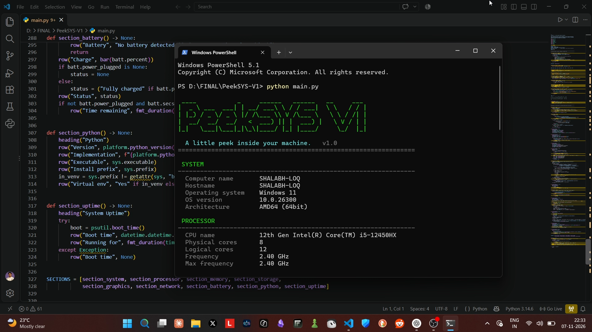

# PeekSYS V1 👀
### A little peek inside your machine.

PeekSYS is a lightweight Python-based PC information utility that automatically detects and displays detailed system specifications directly in your terminal.

From processor details to memory, storage and network information, PeekSYS gives you a quick overview of what's running inside your machine.

---

## Preview



---

## Features

- **System Information** – Computer name, OS, version and architecture.
- **Processor** – CPU name, physical cores, logical cores and frequency.
- **Memory** – Total RAM, used RAM, available RAM and usage percentage.
- **Storage** – Available drives, total capacity, used and free space.
- **Graphics** – GPU information wherever detectable.
- **Network** – Hostname, local IP and network interface details.
- **Battery** – Battery percentage and charging status.
- **Python** – Python version and installation information.
- **System Uptime** – Boot time and total running duration.

## Built With

| Technology | Purpose |
|---|---|
| Python | Core application |
| Psutil | Hardware and system information |
| Platform | OS and processor details |
| Socket | Network information |
| UUID | Network interface information |

## Project Structure

```text
PeekSYS-V1/
│
├── main.py
├── requirements.txt
├── README.md
│
└── screenshots/
    └── screenshot.png
```

## Getting Started

### Prerequisites
- Python 3.9+
- Windows 10 / Windows 11

### Installation

**1. Clone the repository**

```bash
git clone https://github.com/heyshalabh/PeekSYS-V1.git
```

**2. Open the project directory**

```bash
cd PeekSYS-V1
```

**3. Install dependencies**

```bash
pip install -r requirements.txt
```

**4. Run PeekSYS**

```bash
python main.py
```

That's it! PeekSYS will automatically scan and display your PC specifications.

## Privacy

PeekSYS works locally on your computer.

- No login or registration.
- No external data collection.
- No information transmitted to external servers.
- No database or backend required.

## What's Next?

PeekSYS V1 is just the beginning.

Some ideas for future versions:

- [ ] Modern desktop GUI.
- [ ] Live CPU and RAM monitoring.
- [ ] Real-time performance graphs.
- [ ] Exportable system reports.
- [ ] Advanced hardware monitoring.

## Developer

**Shalabh Suman**

Built with Python as a small exploration of system information, hardware detection and practical software development.

[GitHub Profile](https://github.com/heyshalabh)

---

If you find PeekSYS useful, consider giving the repository a ⭐.

**PeekSYS V1 — Take a peek inside your machine.**
